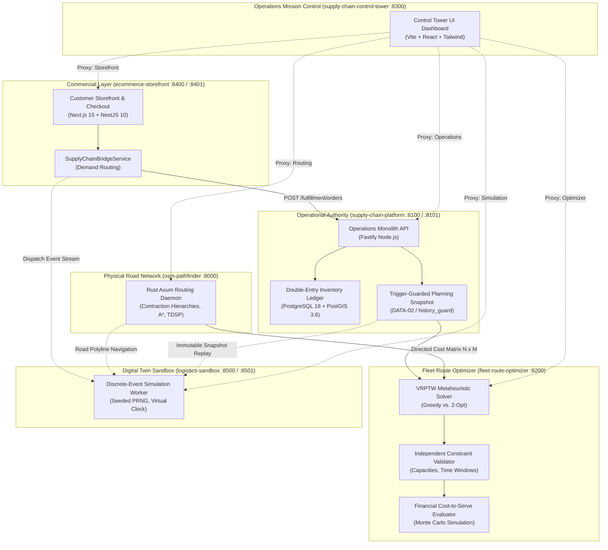
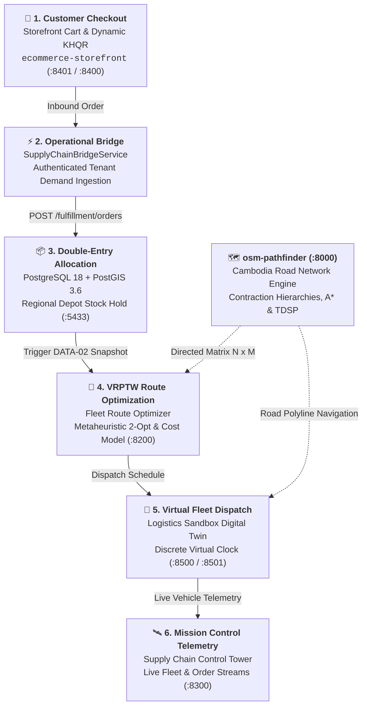

# 🌐 Supply Chain & Logistics Operations Workspace

[](https://nodejs.org)
[](https://pnpm.io)
[](https://www.rust-lang.org)
[](https://postgis.net)
[](https://fastify.dev)
[](https://nestjs.com)
[](https://nextjs.org)
[](https://react.dev)
[](https://docs.docker.com/compose/)
[]()
[](LICENSE)

An enterprise-grade, distributed multi-repository ecosystem uniting physical road routing, transactional double-entry warehouse fulfillment, mathematical fleet route optimization, discrete-event digital twin simulation, omnichannel commercial storefronts, and sovereign operations mission control.

---

## 🏛️ System Architecture

The workspace coordinates six autonomous repositories with decoupled concerns, strict operational boundaries, and typed contracts.



---

## ⚡ Standardized Port Topology (8000 Series)

All ecosystem services adhere to the symmetric **8000 Series (8000–8501)** layout. Internal bridge networking isolates operational databases from simulation workers, and all host ports bind strictly to loopback (`127.0.0.1`) with zero collisions.

| Port | Service / Node | Type | Technology | Purpose & Primary Endpoints |
| :---: | :--- | :--- | :--- | :--- |
| **`8000`** | [`osm-pathfinder`](osm-pathfinder/) | Backend | Rust (Axum, Tokio) | Road network routing, Contraction Hierarchies, A*, TDSP (`/api/route`, `/api/matrix`) |
| **`8100`** | [`supply-chain-platform`](supply-chain-platform/) | Backend | Node.js (Fastify, PostGIS) | Core operational authority, double-entry inventory ledger, fulfillment workflows |
| **`8101`** | [`supply-chain-platform`](supply-chain-platform/) | Web UI | React 19, Vite, TanStack | Warehouse operations console, facility management, stock viewer |
| **`8200`** | [`fleet-route-optimizer`](fleet-route-optimizer/) | Backend | Node.js, TypeScript | VRPTW constraint solver, financial cost-to-serve engine (`/api/v1/optimize`, `/api/v1/evaluate`) |
| **`8300`** | [`supply-chain-control-tower`](supply-chain-control-tower/) | Web App | React 19, Vite, Tailwind | Unified Operations Mission Control: live order stream, fleet tracking, store health matrix |
| **`8400`** | [`ecommerce-storefront`](ecommerce-storefront/) | Backend | NestJS 10, OpenAPI | Commercial catalog, customer cart/checkout, dynamic KHQR payment, operational bridge |
| **`8401`** | [`ecommerce-storefront`](ecommerce-storefront/) | Web App | Next.js 15 (App Router) | Multi-tenant customer storefront, live GPS order tracking, merchant inventory admin |
| **`8500`** | [`logistics-sandbox`](logistics-sandbox/) | Backend | Node.js, Express, WS | Deterministic simulation engine, discrete virtual clock, read-only order ingestion |
| **`8501`** | [`logistics-sandbox`](logistics-sandbox/) | Web UI | React, MapLibre, Deck.gl | Interactive 3D fleet simulation, live replay debugger, vehicle inspection |
| **`5433`** | `postgres` (Container) | Database | PostgreSQL 18 + PostGIS 3.6 | Operational database (`supply_chain_ops`) and planning snapshot store (`distribution_planning`) |

---

## 📦 Repositories & Domain Boundaries

Each subsystem remains an independent Git repository with sovereign versioning and strict operational boundaries:

| Repository | Responsibility & Domain Boundary | Key Milestones & Capabilities |
| :--- | :--- | :--- |
| **[`supply-chain-platform`](supply-chain-platform/)** | Operational authority: warehouses, facilities (`DC-PNH-01`, `DC-REP-01`, `DC-KOS-01`, `DC-BAT-01`), SKUs, double-entry stock ledger, and fulfillment workflows. | `OPS-01` (Master Data), `OPS-02` (Inventory Ledger), `OPS-03` (Fulfillment), `DATA-01` (Exchange), `DATA-02` (Planning Snapshots), `PILOT-01` (Audit Chaining & RBAC). |
| **[`osm-pathfinder`](osm-pathfinder/)** | High-performance physical road network routing engine over OpenStreetMap data for Cambodia. | `ROUTE-01` (Directed Cost Matrix, Contraction Hierarchies, A*, TDSP traffic models, freight truck speed limits, turn penalties). |
| **[`fleet-route-optimizer`](fleet-route-optimizer/)** | Vehicle Routing Problem with Time Windows (VRPTW) solver, independent constraint verification, and financial cost-to-serve analysis. | `OPT-01` (Greedy baseline vs. Metaheuristic 2-opt solver), `EVAL-01` (Financial Cost-to-Serve Monte Carlo simulation, held-out evaluation). |
| **[`logistics-sandbox`](logistics-sandbox/)** | Discrete-event digital twin simulator modeling urban fleet dynamics, delivery routes, and incident responses. | `P0-04` (Deterministic Replay & Seeded PRNG), `P0-05` (Strict Road Routing), `ENV-02` (Containerized Isolation with non-root UID 10001). |
| **[`ecommerce-storefront`](ecommerce-storefront/)** | Omnichannel commercial storefront, product catalog, customer shopping cart, dynamic KHQR payment, and merchant administration. | `P0-02` (Inventory Reservations), `SupplyChainBridgeService` (Live order routing to PostGIS fulfillment), `LiveOrderTrackingMap`. |
| **[`supply-chain-control-tower`](supply-chain-control-tower/)** | Standalone mission control providing unified visibility and operational execution across all five subsystems. | Live order streams, 3D fleet tracking, reverse-proxy microservice health matrix, store directories, and one-click dispatch triggers. |
| **[`supply-chain-workspace`](./)** (Root) | Parent workspace orchestration, Compose profiles, setup scripts, cross-repo integration tests, and shared documentation. | `Setup.ps1`, `Validate.ps1`, `Doctor.ps1`, `Workspace.ps1`, `Run-Pipeline.mjs`, Dual-Track E2E Test Runner (44/44 PASS). |

---

## 🔒 Operational & Planning Invariants (AGENTS.md)

1. **Zero Simulation Write Access (`ENV-02`)**:
   - Simulation workers and route solvers **never** receive operational database write credentials.
   - Simulation and optimization operate exclusively on immutable, tenant-scoped planning snapshots (`DATA-02`).
   - Container bridge networks strictly separate `operations` from `planning`.
2. **Double-Entry Stock Accounting (`OPS-02`)**:
   - Stock allocations require transaction-safe, idempotent reservation semantics in PostgreSQL.
   - Quantities are strictly non-negative integers; floating-point math or blind updates are prohibited.
3. **Trigger-Guarded Planning Snapshots (`DATA-02`)**:
   - Operational data exported for simulation and optimization is protected by PostgreSQL `history_guard` triggers.
   - Artifacts (`facilities.csv`, `skus.csv`, `stock.csv`, `orders.csv`) are validated with root SHA-256 manifests.
4. **Strict Physical Routing Integrity (`ROUTE-01`)**:
   - Unreachable coordinates return explicit `null` cells; the engine never substitutes synthetic straight-line approximations for valid road routes.

---

## 🔄 End-to-End Operational Lifecycle

The ecosystem executes a continuous cross-repository fulfillment and optimization cycle:



### Execution Pipeline Breakdown

| Phase | System & Port | Primary Action | Data Contract & Boundary |
| :---: | :--- | :--- | :--- |
| **1** | **Customer Checkout**<br/>`ecommerce-storefront` (`:8401` / `:8400`) | Customer places order, settles payment via KHQR, and triggers fulfillment. | Emits verified order payload with customer delivery coordinates. |
| **2** | **Demand Bridge**<br/>`SupplyChainBridgeService` | Transparently bridges commercial demand to operational fulfillment. | Authenticated HTTP contract to `supply-chain-platform` (`:8100`). |
| **3** | **Double-Entry Allocation**<br/>`supply-chain-platform` (`:8100` / `:5433`) | Allocates inventory across nearest regional depots (`DC-PNH-01`, etc.) via transactional PostGIS ledger. | Idempotent ledger entries; triggers immutable planning snapshot (`DATA-02`). |
| **4** | **VRPTW Route Optimization**<br/>`fleet-route-optimizer` (`:8200`) | Solves multi-vehicle delivery schedules subject to time windows and capacities. | Ingests directed travel-time matrix from `osm-pathfinder` (`:8000`). |
| **5** | **Virtual Fleet Dispatch**<br/>`logistics-sandbox` (`:8500` / `:8501`) | Dispatches delivery vehicles along real OpenStreetMap geometry in discrete simulation time. | Zero operational database write credentials (`ENV-02` isolation). |
| **6** | **Mission Control Telemetry**<br/>`supply-chain-control-tower` (`:8300`) | Unified oversight of fleet telematics, order streams, store settlements, and system health. | Read-only reverse proxy streams (`/proxy/*`). |

---

## 🚀 Quick Start Guide (PowerShell)

### Prerequisites
- **Git** 2.40+
- **Node.js** 24 LTS & **pnpm** 10.x
- **Docker Desktop** (with Linux containers enabled)
- *(Optional)* **Rust** 1.70+ (container builds use the official Rust image)

### 1. Local Workspace Initialization
Run from the root directory:

```powershell
# 1. Generate local credentials (.secrets/) and verify directories
./scripts/Setup.ps1

# 2. Validate Compose definitions, port registrations, and network isolation
./scripts/Validate.ps1

# 3. Inspect toolchains, Docker engine, and repository links
./scripts/Doctor.ps1
```

### 2. Infrastructure Services Startup

```powershell
# Start base infrastructure (PostgreSQL 18 / PostGIS 3.6 on port 5433)
./scripts/Workspace.ps1 up

# Start infrastructure with the high-performance road router (osm-pathfinder on port 8000)
./scripts/Workspace.ps1 up -Routing

# Start full containerized stack including the digital twin simulator (port 8500/8501)
./scripts/Workspace.ps1 up -Routing -Simulation

# Check container status
./scripts/Workspace.ps1 status

# Verify database connection and transactional grants with a rolled-back probe
./scripts/Verify-Database.ps1
```

### 3. Launching Application Services

To run application microservices on the host:

```powershell
# Terminal 1: Supply Chain Platform (API :8100, Web UI :8101)
cd supply-chain-platform; pnpm dev

# Terminal 2: Fleet Route Optimizer (Solver API :8200)
cd fleet-route-optimizer; pnpm dev

# Terminal 3: Supply Chain Control Tower (Mission Control :8300)
cd supply-chain-control-tower; pnpm dev

# Terminal 4: E-Commerce Storefront (Backend API :8400, Storefront Web :8401)
cd ecommerce-storefront/backend; pnpm start:dev
cd ecommerce-storefront/web; pnpm dev

# Terminal 5: Logistics Sandbox (Backend :8500, Web UI :8501)
cd logistics-sandbox; pnpm dev
```

---

## 🧪 Verification & Test Suites

The workspace includes comprehensive contract, isolation, and end-to-end verification suites:

### 1. Dual-Track E2E Test Runner (44 Tests)
Runs automated verification across determinism, road matrices, boundary conditions, pairwise combinations, and real-world delivery scenarios:

```powershell
node tests/e2e/runner.mjs
```

```text
======================================================================
                       E2E TEST SUMMARY REPORT                        
======================================================================
  ✓ Tier 1: Feature Coverage (P0-04, ROUTE-01, ENV-02)   | 17/17 PASS
  ✓ Tier 2: Boundary & Corner Cases (P0-04, ROUTE-01)    | 16/16 PASS
  ✓ Tier 3: Cross-Feature Combinations (Pairwise)        |  7/ 7 PASS
  ✓ Tier 4: Real-World Scenarios (End-to-End Workflows)  |  4/ 4 PASS
----------------------------------------------------------------------
GRAND TOTAL: 44/44 Passed | 0 Failed | Duration: 21ms
======================================================================
```

### 2. Live Cross-Service Connectivity Probe
Verifies HTTP endpoints and reverse proxies across all six nodes:

```powershell
node scripts/Test-Admin-Connections.mjs
```

### 3. Full Cross-Repository Pipeline Run
Executes a complete planning snapshot, cost matrix calculation, VRPTW route solve, financial evaluation, and simulation replay:

```powershell
node scripts/Run-Pipeline.mjs
```

---

## 📂 Repository Directory Layout

```text
supply-chain-workspace/
├── .secrets/                             # Local passwords (git-ignored, never committed)
├── compose.yaml                          # Base Compose (PostgreSQL 18 + PostGIS 3.6, Routing, Sandbox)
├── compose.osm.yaml                      # Real OpenStreetMap .pbf overlay
├── workspace.json                        # Sovereign registry: ports, repos, baseline revisions
├── scripts/
│   ├── Setup.ps1                         # Local credentials & directory bootstrap
│   ├── Validate.ps1                      # Port, Compose, and Git isolation validator
│   ├── Doctor.ps1                         # Toolchain and Docker diagnostic check
│   ├── Workspace.ps1                     # Compose up/down/status lifecycle manager
│   ├── Verify-Database.ps1               # Non-destructive rolled-back database probe
│   ├── Test-Admin-Connections.mjs        # Cross-ecosystem connectivity test suite
│   └── Run-Pipeline.mjs                  # End-to-end cross-repository pipeline executor
├── tests/e2e/                            # Dual-Track E2E Test Suite (Tiers 1–4)
├── docs/
│   ├── ARCHITECTURE.md                   # System boundaries and data flow specification
│   ├── PLAN.md                           # Milestone reconciliation and work streams
│   ├── BACKLOG.md                        # Prioritized backlog and completion tracking
│   └── SETUP_STATUS.md                   # Local verification evidence and milestones
├── osm-pathfinder/                       # Rust Axum routing engine (:8000)
├── supply-chain-platform/                # Operational warehouse & inventory monolith (:8100/:8101)
├── fleet-route-optimizer/                # VRPTW solver & cost-to-serve engine (:8200)
├── supply-chain-control-tower/           # Operations mission control dashboard (:8300)
├── ecommerce-storefront/                 # Omnichannel catalog, checkout & demand bridge (:8400/:8401)
└── logistics-sandbox/                    # Discrete-event digital twin simulator (:8500/:8501)
```

---

## 📚 Documentation Index

- 📖 [System Architecture & Data Flows](docs/ARCHITECTURE.md)
- 📋 [Implementation Plan & Reconciliation](docs/PLAN.md)
- 📌 [Milestone Verification & Setup Evidence](docs/SETUP_STATUS.md)
- 🎯 [Prioritized Engineering Backlog](docs/BACKLOG.md)
- 📜 [Agent Instructions & Operational Invariants](AGENTS.md)

---

## 📄 License

This workspace and its constituent repositories are licensed under the [MIT License](LICENSE).
