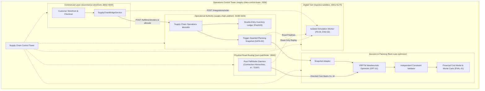

# Workspace architecture

## Domain owners

| Boundary | Owner | Authority |
|---|---|---|
| Warehouses, SKU stock, reservations, fulfillment, shipments | supply-chain-platform | Operational records & double-entry ledger |
| Road graph, snapping, route/matrix costs and geometry | osm-pathfinder | Physical road network routing |
| Clock, actors, incidents, seeded scenarios, run events | logistics-sandbox | Synthetic world & digital twin |
| Constraint optimization (VRPTW), cost models, scenario comparisons | fleet-route-optimizer | Mathematical optimization & evaluation |
| Commercial storefront, customer checkout & demand bridge | ecommerce-storefront | Commercial storefront authority |
| Operations control tower, ecosystem monitoring & interactive dispatch | supply-chain-control-tower | Ecosystem operations control tower |
| Local bootstrapping, containers, environment, common docs | supply-chain-workspace | Development orchestration |

## Storage and credentials

One local PostGIS server hosts two distinct databases. `operations_app` accesses
`supply_chain_ops`; `planning_app` accesses `distribution_planning`; `snapshot_reader` can select
`operations_app`-owned public tables. Neither application role is a superuser.
Operational and planning databases revoke PUBLIC connect privileges. The bootstrap
creates roles/extensions; `supply-chain-platform` owns business migrations (001–005).

Simulation and optimization workers receive frozen artifacts and planning credentials only. The snapshot
extractor (`DATA-02`) generates tenant-scoped immutable CSV artifacts (`facilities.csv`, `skus.csv`, `stock.csv`, `orders.csv`)
protected by the PostgreSQL trigger `history_guard` and root manifest SHA-256 digests.

## Runtime topology available now

- **PostgreSQL 18 / PostGIS 3.6**: operations network; local-only host port 5433; persistent named volume.
- **Router (osm-pathfinder)**: planning network; local host port 3000 (Compose profile `routing`); no database secrets. Builds existing Rust source with `Cargo.lock`.
- **Logistics Sandbox**: planning network; local host ports 3001/5173 (Compose profile `simulation`); non-root user (UID 10001); zero operational database credentials or access to the `operations` network (ENV-02).
- **Supply Chain Platform**: host API/UI running on loopback ports 3100/3101; modular Fastify monolith with native `pg`, forced tenant RLS, double-entry inventory ledger, demand fulfillment, and trigger-guarded planning snapshots.
- **E-Commerce Storefront Engine**: host API/web running on ports 4000/3001; bridges orders directly to `supply-chain-platform` via `SupplyChainBridgeService` and notifies `logistics-sandbox`.
- **Platform Admin HQ**: host app running on port 3300; unified control plane monitoring nodes, stores, order streams, simulation, routing, and intelligence.
- **Distribution Intelligence**: independent TypeScript worker implementing VRPTW metaheuristics, independent constraint validation, and multi-seed Monte Carlo scenario comparison.

Host ports bind to loopback (`127.0.0.1`). Services use separate bridge networks (`operations` vs `planning`).
The dual-track E2E test runner (`node tests/e2e/runner.mjs`) verifies 44/44 contract and boundary gates across all tiers.
The cross-repository planning pipeline (`node scripts/Run-Pipeline.mjs`) verifies the complete integration cycle.
