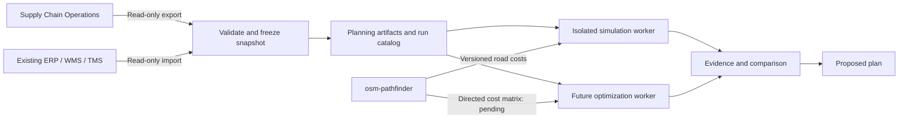

# Workspace architecture

## Domain owners

| Boundary | Owner | Authority |
|---|---|---|
| Warehouses, SKU stock, reservations, fulfillment, shipments | supply-chain-platform | Operational records |
| Road graph, snapping, route/matrix costs and geometry | osm-pathfinder | Physical routing |
| Clock, actors, incidents, seeded scenarios, run events | logistics-sandbox | Synthetic world inside a run |
| Constraint optimization, experiments, comparisons | distribution-intelligence (future) | Proposed decisions |
| Local bootstrapping, containers, environment, common docs | supply-chain-workspace | Development orchestration |
| Marketplace and data-engineering examples | ecommerce-hive-nosql | Its own demo only |

All arrows other than existing legacy calls are target contracts. This diagram is not
a claim that the integration flow is already implemented. Controlled write-back is later.

## Storage and credentials

One local PostGIS server initially hosts two distinct databases. operations_app accesses
supply_chain_ops; planning_app accesses distribution_planning; snapshot_reader can select
future operations_app-owned public tables. Neither application role is a superuser.
Operational and planning databases revoke PUBLIC connect privileges. The bootstrap
creates roles/extensions only; the platform owns business migrations.

Simulation will receive frozen artifacts and a planning account only. The snapshot
extractor is a distinct process/identity. It must explicitly select tenant-scoped approved
data. SQL read-only access alone is not authorization, tenant filtering or a production
security boundary. Those require implementation and adversarial tests before real data.

## Runtime topology available now

- PostgreSQL: operations network; local-only host port 5433; persistent named volume.
- Optional routing: planning network; local-only host port 3000; no database secrets.
- The services use separate bridge networks; no application container bridges them.
  Host ports bind to loopback. These local networks are not a production egress firewall;
  simulator credential/egress enforcement remains a Phase 0 implementation gate.
- No legacy marketplace, simulator or synthetic telemetry sink is started by default.
- supply-chain-platform host API/UI now runs OPS-01 on loopback ports 3100/3101.
  Its master-data, inventory and workflow migrations are app-owned. OPS-02 ledger/reservation
  commands/reconciliation and OPS-03 fulfillment/shipping are implemented locally. No simulation connector writes
  to operational authority.
- Router Dockerfile is owned by infrastructure and builds the existing Rust source with
  Cargo.lock. Runtime listens on 0.0.0.0 and runs as a non-root user.
- Demo graph is explicit. A real-PBF overlay mounts an existing file read-only. It does
  not establish graph provenance, restriction correctness or traffic calibration.

## Near-term application shape

The new platform starts as a NestJS/TypeScript modular monolith and an independent
React operations UI. The accepted detailed design is in
[platform architecture](../supply-chain-platform/docs/ARCHITECTURE.md) and
[ADR-0003](../supply-chain-platform/docs/decisions/0003-scalable-operations-architecture.md):
Nest/Fastify, PostgreSQL/PostGIS with native pg, React/Vite with React Router/TanStack Query,
backend domain/application library, generated OpenAPI client and separate operational
workers when durable jobs are introduced. ARCH-01 alignment is verified locally; see
[the implementation evidence](../supply-chain-platform/docs/ARCHITECTURE_VERIFICATION.md).
Redis/workers and production capacity remain pending; operational credentials stay isolated.

Keep inventory, fulfillment, shipping, identity and imports as
modules with clear transactional boundaries; do not create a service per entity.
Use tenant/source identities, UTC instants plus an IANA business zone, integer minor-unit
money, meters/seconds/kg/m3, and explicit data provenance. Contracts must distinguish
observed, simulated, estimated, cached/stale and unavailable states.

Worker APIs are asynchronous when workloads require it. Version snapshot manifests,
routing metadata, event schemas and solver diagnostics. Independent validation checks
every hard constraint; a time-limited feasible answer is not a proof of optimality.

## Adding the legacy simulator to Compose

Before adding it, implement endpoint configuration, disable upstream writes by default,
fix source compilation failures, and verify runtime pause/clock behavior. Provide
ROUTING_BASE_URL=http://routing:3000, separate read/write adapters, an explicit disabled
egress policy and in-memory/planning-only persistence. These are requirements, not
environment variables that magically control the current implementation.

Add frontend proxy configuration for the backend's service name. Add health checks and
service_healthy dependencies, contract tests, and no operations database secrets. A
simulation profile can then be introduced with an actual isolated runnable stack.
