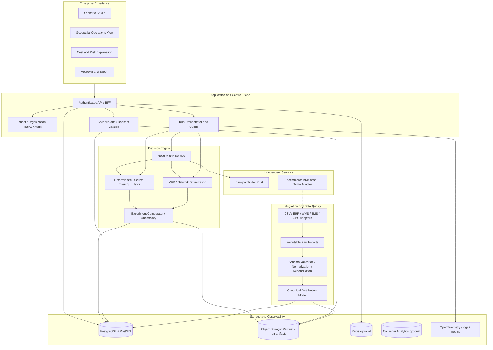

# Enterprise Distribution Intelligence Platform — Architecture & Execution Blueprint

**Prepared:** 8 October 2026  
**Scope:** `mengchheanglong/logistics-sandbox`, `mengchheanglong/ecommerce-hive-nosql`, `mengchheanglong/osm-pathfinder`  
**Status:** Research-based proposal and source-code audit, **not** a claim of production readiness or a tested deployment.

## 0. Executive decision

**Build a distribution-network decision and optimization layer for large distributors, manufacturers, retailers, and 3PLs.** Do **not** initially attempt to replace enterprise ERP, WMS, OMS, or TMS. Start with read-only imports of historical orders, deliveries, facilities, fleet, costs, and service-level commitments. Reconstruct the current network; estimate and validate cost-to-serve; run optimization scenarios; and show tradeoffs with auditable evidence. Human approval precedes any production write-back.

**Initial wedge:** domestic, multi-depot distribution of FMCG/wholesale/retail goods, with multi-stop trucks and vans, depot constraints, customer appointment windows, mixed fleet, and partial deliveries. The focus is operational planning (day/week) and tactical distribution-network experiments (month/quarter). International freight, customs, freight tendering, container visibility, manufacturing execution, and full WMS functions are excluded from the first product.

**Differentiation hypothesis to validate:** transparent, reproducible and regionally configurable distribution what-if planning that integrates with incumbent enterprise software and needs less implementation burden than comprehensive supply-chain suites. Established competitors already offer serious transportation modeling and supply-chain simulation; differentiation must be demonstrated through pilot evidence.

## 1. Source-code audit: confirmed and unverified

### 1.1 `logistics-sandbox`

Actual source paths under `backend/` and `frontend/` (the README's `apps/` paths do not match the current tree). Express/TypeScript world runtime, generated and e-commerce orders, vehicle movement, scenario presets, incidents, multi-stop dispatch, WebSocket, MapLibre/deck.gl front end. Unit tests under `backend/tests/`. Persistence factory provides MongoDB orders and Cassandra telemetry adapters, but the implementation mostly proxies to `ecommerce-hive-nosql` HTTP APIs and maintains in-memory fallbacks. The event bus uses an in-memory `EventEmitter` with growing in-process history.

**Critical findings:**

1. `backend/src/routing/client.ts`: if the routing service is unavailable, `calculateRoute` returns a straight line marked `fallback_direct`. Enterprise scoring must fail closed or mark the run invalid/approximate.
2. `backend/src/simulation/engine.ts`: uses wall-clock `Date.now()`, random `Math.random()` to sample telemetry, and random `Math.random()` in ecommerce-order position selection. This defeats a strict same-input/same-seed/same-output guarantee.
3. `backend/src/simulation/engine.ts` calls `this.ecommerceClient.sendRiderPing(...)` as well as `this.persistence.telemetry.savePing(...)`; the configured adapter also forwards pings upstream. This may cause duplicate upstream telemetry events when connected.
4. `backend/src/simulation/engine.ts` calls `ecommerceClient.adjustStock()` when simulated deliveries complete. `backend/src/integrations/ecommerce.ts` exposes live order creation and fulfillment mutation. **No simulation path should be allowed to mutate a real marketplace**.
5. `backend/src/dispatch/vrp.ts` uses capacity batching and a nearest-neighbor TSP-like stop heuristic with calls to the routing API. It is not a general industrial VRPTW optimizer; the existence of time-window scenarios is not equivalent to a proven feasibility-constrained VRPTW solver.
6. Async `save*` calls frequently use `.catch(() => {})`, with limited durability and acknowledgment. There is no demonstrated transactional outbox or persisted immutable run-event log.
7. The routing adapter defaults to `contraction_hierarchies` and `metric=time`; correctness requires algorithm/metric-specific validation against reference solutions.

### 1.2 `ecommerce-hive-nosql`

NestJS + MongoDB orders/catalog, Redis cart, Neo4j referral, Cassandra schema, Hive/HDFS sample analytics. Useful for integration methods and workload examples. It is not a fully realized enterprise order management/warehouse/transport execution system.

**Critical findings:**

1. `backend/src/orders/orders.service.ts` decrements MongoDB product stock in `create()` on order creation. `backend/src/catalog/catalog.service.ts` separately exposes `adjust-stock` that also decrements stock. Together with sandbox-delivery `adjustStock()`, an order may have stock deducted twice (or more). Neither flow establishes robust stock reservation/cancellation semantics.
2. `backend/src/telemetry/telemetry.service.ts` reports a static fleet array and hard-coded throughput metrics. `recordPing()` updates an in-memory rider if it matches, while reporting that a Cassandra ping was recorded. The endpoint **does not demonstrate a real Cassandra insert**. Do not report 160 writes/s or 13.8M/day as observed infrastructure throughput.
3. Several services use fallback data on database errors. This can be helpful for demos but hides source-of-truth failures. A live enterprise integration must explicitly distinguish cached, stale, synthetic, and failed states.

### 1.3 `osm-pathfinder`

Rust/Axum OSM ingest, R-tree, Dijkstra, A*, bidirectional algorithms, CH, synthetic congestion, isochrones. The 7 October change adds bounded witness search and time-progressed congestion evaluation. These are meaningful algorithmic improvements but do not constitute full validation for production truck routing.

**Critical findings:**

1. `src/main.rs`: if PBF is not supplied or the path does not exist, loads a 44-node Cambodia demo graph. Reject demo graph as a benchmark basis for enterprise coverage.
2. `src/pathfinding/ch.rs`: CH query processes separate forward and backward expansions and scans all nodes for a meeting point; performance for full-country graph is not established. Time/distance shortcut correctness across preprocessing metrics needs equivalence tests.
3. `src/osm/parser.rs`: handles highway and basic one-way tags; do not assume robust vehicle restrictions, signed turn restrictions, bridge restrictions, truck height/weight, legal access, ferry/toll, road closures, etc.
4. Synthetic traffic is **not** a calibrated historical/live traffic feed. Travel-time calibration against field data is mandatory before commercial estimates.
5. OSM database is licensed ODbL; attribution and database-use compliance must be reviewed. See https://www.openstreetmap.org/copyright.

### 1.4 Evidence levels

- **Confirmed in source:** modules, endpoints, data structures, chosen algorithms, fallbacks, tests.
- **Claimed but not independently measured:** full-PBF latency, live Cassandra throughput, strict reproducibility, realistic travel times, enterprise scalability and availability.
- **Not observed here:** deployed production tenants, operational customer datasets, independent performance test runs, SOC 2/ISO audits, reliable integration with real WMS/TMS/ERP.

## 2. Market position and competitors

| Category | Reference | Already available commercially | Implication for this product |
|---|---|---|---|
| Enterprise transportation execution | Oracle OTM; SAP TM | Freight units, shipment planning, carrier/rate/financial workflows | Integrate instead of compete across full breadth |
| Transportation modeling | Blue Yonder Transportation Modeler | What-if network scenarios connected to TMS | Simulation alone is not novel |
| Supply-chain design / digital twins | anyLogistix | Inventory/network optimization, what-if simulation, map animation and real-data connectors | Must differentiate by onboarding, validated regional models or particular workflow |
| Visibility | project44 | Multi-carrier connectivity, shipment tracking and ETA | Do not claim equivalent real-time coverage without integrations |
| Open solver | VROOM; Google OR-Tools | VRP capacity, time windows, pickups, deliveries | Baseline solvers should be reused and benchmarked, not reimplemented first |

**Discovery hypotheses:** large regional FMCG distributors may have fragmented spreadsheets, ERP exports, custom operational practices, and inefficient fleet allocation. These are plausible opportunities, not verified facts for any named company. Interview target operators before building product-market-specific features.

## 3. Target operating model

**Customer:** multi-depot distributor (e.g. 5–50 distribution sites, 50–2,000 delivery vehicles, thousands of daily stops; these are illustrative segmentation ranges, not verified market statistics).  
**Champion:** supply-chain / distribution planning manager.  
**Economic buyer:** COO, head of logistics, or supply-chain director.  
**Daily user:** network planner, transport dispatcher, operations analyst.  
**Gatekeepers:** IT integration, security/privacy, finance, procurement.

**Primary user journey:**

1. Connect or upload historical demand/order, stop/delivery, vehicle/driver, depot, route, cost and inventory snapshots.
2. Run data validation: IDs, coordinates, coverage, missing fields, timing, units, duplicates and temporal consistency.
3. Reconstruct baseline operational metrics and display discrepancies versus reported data.
4. Freeze a versioned network snapshot; declare cost rules and forecast assumptions.
5. Choose intervention: depot closure/opening, fleet mix, delivery zones, route consolidation, shift windows, demand peak, road disruption.
6. Run baseline and candidate optimizations under identical data and comparable random conditions.
7. Compare feasibility, service, costs, utilization, failure exposure, and uncertainty. Display route geometries and simulator state as evidence.
8. Produce an audit-ready decision brief with assumptions, model versions, data quality, explainability, and named approvals.
9. Export a plan. **Only after explicit approval** permit write-back through a separate controlled integration.
10. Later ingest realized outcomes; measure prediction error and recalibrate.

## 4. Reference architecture



### 4.1 Deployable boundaries

**A. Product/API (TypeScript, NestJS recommended for enterprise service governance; existing Express runtime can remain as simulation worker).** Owns organizations, data-import status, scenario metadata, run lifecycle, approvals, authorization, exports, API contracts. Start as a modular monolith. Do not create a microservice for every domain.

**B. Ingestion workers (TypeScript or Python).** Own connectors, raw data retention, schema parsing, temporal/geographical validation, canonical normalization and idempotent import/reconciliation. Separate service account from any eventual write-back credentials.

**C. Simulation worker (reuse `logistics-sandbox`, refactored).** Owns simulation clock, event scheduler, actors, world state, seeded randomness, deterministic event ordering, snapshots, replay and scenario results. Must never call live write APIs. Run as ephemeral isolated jobs.

**D. Optimization worker (initially Python + OR-Tools; evaluate VROOM).** Owns full scenario constraint solving. Receives immutable problem instances plus travel-cost matrix, emits solution and diagnostic metadata. Distinguish feasible, infeasible, timed-out, approximate, optimality-not-proven.

**E. Routing/matrix worker (reuse Rust `osm-pathfinder`).** Owns road-network graph, snapping, travel time matrix, per-vehicle restrictions as supported, route geometry, map version. Can be replaced/augmented by certified commercial routing where necessary.

**F. Analytical data layer.** Query dashboards and scenario differences without dragging full telemetry back through OLTP. Start with Postgres aggregate views and object storage; add ClickHouse/Trino/Iceberg only if workload proves it necessary.

### 4.2 Operational versus scenario boundary — mandatory

```
REAL OPERATIONAL SYSTEMS                SANDBOX / PLANNING
ERP/WMS/TMS/GPS                         immutable snapshot
   | (read-only credential)                    |
   v                                           v
Ingestion -> normalize -> version -> sandbox simulator + solver
                                               |
                                               v
                                        proposed plan / comparison
                                               |
                                         human approval
                                               |
                       separate exporter/write-back credentials
                                               |
                              conditional write to live TMS only
```

No simulation worker may possess production write credentials. Scenario-specific orders, simulated delivery completion, and synthetic GPS must be scoped to simulation IDs and never be merged with real orders without explicit export policy.

## 5. Bounded product scope

### Included first

- Facility/depot, customer stop and transport-zone master data
- Inbound CSV/Excel/API read-only import and validation
- Historical route and delivery reconstruction
- Multi-depot delivery tour planning and VRPTW constraints
- Fleet capacity (mass, volume, pallets), vehicle availability, shifts, load/unload service times
- Per-route/stop operating cost and customer service windows
- What-if scenarios: fleet mix, depot assignment, schedule, demand changes, disruption
- Audit trail, scenario comparator, visual playback, downloadable decision brief

### Later

- Cold chain, regulatory vehicle restrictions where road data verified, returnable packaging, reverse logistics, cross-docking, inter-depot linehaul, outsourced carrier contract rules, probabilistic demand, inventory network optimization, near-real-time monitoring, controlled production write-back.

### Excluded initially

- Full procurement/ERP, WMS put-away/picking, billing/settlement, multinational customs, multi-modal freight, mobile driver marketplace, AI-agent autonomous execution, commodity carrier visibility network, robotics, warehouse physics, carrier marketplace.

## 6. Canonical domain model (starting point)

**Tenant and network:** `Tenant`, `Organization`, `User`, `Role`, `Facility`, `Dock`, `Region`, `Zone`, `RoadNetworkVersion`, `Lane`.

**Commercial demand:** `Customer`, `Order`, `OrderLine`, `SKU`, `DeliveryRequest`, `Shipment`, `Stop`, `TimeWindow`, `ServiceLevelAgreement`.

**Supply:** `Vehicle`, `VehicleType`, `Carrier`, `Driver`, `Shift`, `CapacityProfile`, `HandlingCapability`, `DepotInventorySnapshot`.

**Planning:** `TransportCostModel`, `RateCard`, `DispatchPolicy`, `RoutePlan`, `Tour`, `TourStop`, `PlanAssignment`, `ConstraintViolation`.

**Experiments:** `DatasetImport`, `DataQualityReport`, `NetworkSnapshot`, `ScenarioDefinition`, `ScenarioRun`, `RunEvent`, `OptimizationResult`, `Comparison`, `ModelCalibration`, `Approval`.

**Tracking (future read-only):** `VehiclePosition`, `DeliveryMilestone`, `ProofOfDelivery`, `Exception`, `ObservedTrip`.

**Model distinctions:**
- `Order` = customer demand (possibly multiple items); `Shipment` = fulfillment transportation unit, possibly consolidating/splitting orders.
- `Stop` = physical activity with service time; `Tour` = ordered sequence of stops for vehicle and driver.
- `Facility` = actual node in commercial network; not a generic map marker.
- `ScenarioDefinition` = assumptions and alterations; `NetworkSnapshot` = immutable baseline; `ScenarioRun` = one execution using pinned algorithm/data versions.
- `InventorySnapshot` is a read-only estimate of available inventory, NOT an assertion of real-time warehouse truth.

Use UUIDv7 or stable UUIDs internally; `external_id` plus `source_system` and `tenant_id` for upstream identity mapping. Use UTC instants and IANA zone (`Asia/Phnom_Penh` initially). Distances in meters; time in seconds; weights in kilograms; volumes in cubic meters; money as integer minor units with explicit currency. Address/coordinates preserve geocoding confidence and version. Do not put all data in a `payload: any` field.

## 7. Core contracts

### 7.1 Immutable scenario input

```json
{
  "scenario_id": "sc_001",
  "tenant_id": "org_demo",
  "snapshot_id": "snap_2026_10_08_v3",
  "scenario_version": 2,
  "simulation_seed": 82134,
  "start_at": "2026-10-08T00:00:00Z",
  "horizon_hours": 24,
  "routing": {"graph_version": "kh_2026_10", "cost_model_version": "cm_v3", "vehicle_profile": "van"},
  "optimizer": {"engine": "ortools", "config_version": "solver_v1", "time_limit_seconds": 120},
  "interventions": [{"type": "depot_unavailable", "facility_id": "DEPOT_B", "from_simulated_hour": 5}],
  "objectives": {"minimize": ["total_distributed_cost"], "hard_constraints": ["vehicle_capacity", "driver_shift", "customer_window"]}
}
```

Snapshot contents identified by content hashes, not mutable external API URLs. Include snapshots of fleet, orders, costs, traffic assumptions, route graph, policies and constraints. Tenant scope applies to every object and artifact.

### 7.2 Normalized events

```json
{
  "event_id":"evt_01",
  "tenant_id":"org_demo",
  "scenario_run_id":"run_001",
  "simulation_timestamp":"2026-10-08T04:12:00Z",
  "event_sequence": 103,
  "entity_type":"vehicle",
  "entity_id":"V17",
  "event_type":"vehicle.arrived",
  "schema_version":"1",
  "payload":{"stop_id":"S33","location_id":"CUSTOMER_33"},
  "source":"simulation"
}
```

Event ordering key `(simulation_timestamp, priority, event_sequence)`. A seeded, deterministic pseudo-random stream per actor/event class avoids global ordering-induced random drift. Persist route responses or a versioned cost matrix for replay. Event timestamps are simulation time; ingestion timestamps are separate real time; synthetic events must carry provenance.

### 7.3 Optimization service

```
POST /v1/optimization-jobs
  {tenant_id, scenario_run_id, snapshot_ref, cost_matrix_ref, solver_config_ref}
-> {job_id, state: queued}

GET /v1/optimization-jobs/:id
-> {state, progress, infeasibility_summary, diagnostics, artifact_refs}
```

Return `status=feasible|infeasible|timeout|error`, not an unconditional `success=true`. Report elapsed runtime, objective value, bound if available, unserved demand, hard-constraint violations, and version IDs.

### 7.4 Route cost matrix

`POST /v1/matrix` with start/end coordinate arrays, vehicle profile, travel-time departure bucket, and graph/cost-model versions. Response provides a **directed** matrix for time/distance, unavailable edges, snapping confidence, method and fallback flag. Never silently approximate a blocked or unknown road with straight line. Cache by versioned key. For large matrices, return an async job and tiled artifacts rather than huge synchronous JSON.

## 8. Algorithms, cost model and metrics

### 8.1 Solver design

`osm-pathfinder` computes single-source/point-to-point road cost. It **does not solve VRP**. A distinct optimizer consumes road cost matrices and must enforce: multi-depot vehicle assignment, weight/volume/pallet capacity, delivery windows, pickup-before-drop-off, service times, shifts and breaks, equipment capabilities, route duration/distance, optional orders and unserved penalties.

**Step 1:** Current nearest-neighbor and route-aware greedy as baseline.  
**Step 2:** Google OR-Tools as robust constraint-solving baseline.  
**Step 3:** VROOM benchmark for large, fast vehicle routing.  
**Step 4:** Custom algorithms only when measured constraints or speed require them.

Vehicle routing is computationally hard; time-limited solvers often produce good feasible routes without proving optimality. Report this honestly.

### 8.2 Cost-to-serve objective

```
TotalDistributionCost =
  fleet_fixed_allocation + driver_labor
  + distance_km * variable_vehicle_cost_per_km
  + fuel / energy_cost + tolls + carrier_rate
  + load/unload_handling + depot_processing
  + lateness_penalties + unserved_order_penalties
  + relevant fixed_facility_scenario_changes
```

Define currency, cost period, cost allocation rules, and who supplied each assumption. Freight rate cards can vary by geography, weight, volume, mode and service level; a raw distance-only objective is not sufficient for serious enterprise recommendations.

**Hard constraints** cannot be bought away casually: legal weight limit, dispatch eligibility, contractual appointment windows marked strict, prohibited routes, cold-chain requirements. **Soft constraints** can have visible penalties and sensitivity settings. Optimize multiple objectives only after publishing weights/tradeoffs: cost, OTIF, fleet hours, equity and carbon.

### 8.3 Evaluation and uncertainty

Measures:
- OTIF = orders meeting BOTH on-time and in-full criteria / all eligible orders; define customer-specific tolerance.
- Cost per delivered case/pallet/order and cost per tonne-km (as appropriate).
- Total cost, vehicle km, empty km, stop count, fleet utilization, dock wait, route duration, vehicle-hour demand.
- Unserved stops, violated constraints, lateness distribution p50/p90/p95; ETA absolute error.
- Robustness: performance under disruptions, demand variability and road time uncertainty.

Reconstruct a historical baseline first, compare predicted baseline against actual history using held-out dates, report calibration deltas and data-quality coverage. Use **common random numbers** to compare scenarios. Run multiple seeds when uncertainty matters and show distribution/CI rather than a single deterministic savings number. Never claim calculated savings as realized savings until a real-world pilot validates them.

## 9. Data infrastructure recommendation

| Component | First enterprise version | Later trigger |
|---|---|---|
| Transactional/application DB | PostgreSQL + PostGIS for organizations, canonical data, scenarios, approvals | Split per tenant or add read replicas if required |
| Raw input and run artifacts | S3-compatible object storage, compressed JSON/Parquet, hashes and retention | Lakehouse tables as data accumulates |
| Cache and live fleet projection | Redis optional | High read concurrency / genuinely live fleet |
| Routing | Rust `osm-pathfinder`, externally validated | Alternate/managed provider if vehicle legality / traffic data needs it |
| Optimization | OR-Tools worker; VROOM comparator | Portfolio solvers, custom constraints |
| Message/work queue | Durable DB-backed jobs or queue; transactional outbox for real operations | NATS JetStream/Redpanda/Kafka when throughput and cross-system semantics justify |
| GPS history | PostgreSQL partitions/columnar analytics initially | Cassandra/ScyllaDB at proven append throughput and retention needs |
| Relationship traversal | Postgres joins/recursive CTE first | Neo4j when dependency graph queries are sufficiently complex and stable |
| Analytics | SQL aggregates + Parquet initially | ClickHouse/Trino/Iceberg at scale |
| Hive/HDFS | Keep as educational integration reference | Only deploy if customer environment explicitly requires it |

Do not inherit a five-database architecture simply because it exists in a course project. Run operational and synthetic telemetry separately. Never let async simulation writes mutate live warehouse stock.

## 10. Enterprise integration strategy

**Inbound first:** CSV/XLSX from ERP/WMS/TMS, scheduled SFTP, REST integrations, ERP database export in read-only mode. Define canonical mappings for external IDs, locations, shipments, line items, capacities, time zones, financial rates, and null values. Maintain immutable raw source, validation report, sanitized canonical version, lineage metadata, retry and duplicate handling.

**Interoperability:** transport integrations may require EDI X12/EDIFACT or an incumbent TMS's native API; GS1 EPCIS 2.0 is a useful model for traceability events and shipment-related identifiers, but should not be mandated for every pilot. Support configurable enterprise rate cards and carrier reference data. Verify legal/contractual rights to customer feeds.

**Outbound (later):** proposal and plan exports by file/API; only after an approval workflow, a separate service account, per-tenant scope and idempotency key; dry-run preview, reconciliation and rollback/recovery policy. No LLM or simulator direct production mutation.

**Ingestion gates:** reject or quarantine invalid locations, impossible timestamps, duplicate identifiers, unknown units, negative demand, inconsistent fulfillment transitions and unresolvable geocoding. Show `coverage %` for records and costs and a list of assumptions used for missing data. Missing cost inputs must NOT be silently replaced by magic constants.

## 11. Security, deployment and operations

**Pilot default:** isolated tenant deployment or carefully constrained multi-tenant SaaS. Enterprise buyers often require a documented tenant isolation model, data residency review, auditability, disaster recovery procedures and supplier security evidence. A private managed deployment may be easier for initial high-sensitivity pilots.

Required controls before accepting real customer production-like data:
- SSO (OIDC initially, SAML/SCIM when required), granular organization/facility RBAC/ABAC.
- Tenant ID enforced in DB, object store, cache key, queue job, logs and artifact access; cross-tenant adversarial tests.
- TLS, secrets manager, least-privilege service identities, encryption at rest and in transit, secret rotation.
- Immutable audit log for dataset imports, scenario changes, approvals and exports.
- PII minimization, pseudonymization, retention/deletion policy, backups/restores, access logging.
- Background job quotas, cancellation, retry policy, dead-letter handling, bounded worker resources.
- Metrics/traces/logs, alerts for failed ingestion, missing GPS, route fallback, poor geocoding, solver timeout, replay mismatch.
- Unit/integration/contract/chaos/recovery tests; container image vulnerability scanning and dependency provenance.

**Performance and reliability:** propose initial engineering targets only after tests. Pilot gate examples (not achieved measurements): 1000-stop/100-vehicle benchmark within a time budget chosen with customer; p95 API read under 500ms at agreed concurrent load; no cross-tenant data leaks in automated tests; 100% routing provenance in recommendation output; deterministic run hash for pinned inputs. SLOs and capacity plans must be established from measured workloads.

**Map/data licensing:** credit OSM and follow ODbL rules; do not bulk use public OSM map tile servers beyond policy; host or license appropriate tile service. Verify commercial permissions for any purchased traffic feeds.

## 12. User experience and workflows

**Workspace A — Data Readiness:** connectors, source mapping, import errors, geocoding coverage, baseline confidence, cost completeness.

**Workspace B — Distribution Network:** facilities, customer clusters, service zones, vehicle mix, capacity utilization, actual road travel time, costs.

**Workspace C — Scenario Studio:** duplicate immutable snapshot, declare interventions and assumptions, choose objectives, submit job, budget, run version, control random seed.

**Workspace D — Decision Comparison:** baseline vs alternatives with cost/service/risk delta, feasibility list, sensitivity charts, Pareto tradeoffs, per-customer impact, high-level trace of why plans differ.

**Workspace E — Visual Replay:** map movement driven only from frozen simulation outputs or actual read-only telemetry, pause/scrub, compare routes, inspect failure, see origin event/source provenance.

**Workspace F — Governance:** roles, approval workflow, audit trail, export gate, model validation report, integration health.

Start with A+C+D. A spectacular 3D map is secondary to data credibility and planner workflow.

## 13. Phased roadmap with explicit exit gates

These are proposed planning estimates for a small, focused team, not delivery guarantees. A solo developer should plan substantially more time.

### Phase 0 — Safety and truthfulness, weeks 0–3
- Remove/switch off upstream `createMarketplaceOrder`, `updateOrderStatus`, `adjustStock`, `sendRiderPing` from all simulated scenarios by default; require explicit `demo-sink` for synthetic integration.
- Confirm/fix double stock-deduction semantics in e-commerce demo (reserve once, release on cancel, deduct on ship according to defined business policy); idempotency and inventory checks.
- Replace random/wall-clock source in world transition with injected clock/RNG, fixed timestep and seeded event ordering.
- Implement `routing_mode=strict` that fails scenario if Rust route is absent or demo graph is used; record graph version and fallback count.
- Treat fake Cassandra response metrics as fixtures. Replace with real insert/ack/query evidence or label them demonstration only.
- Build baseline integration contract tests and deterministic replay test with identical snapshot, seed, and pinned route matrix.

**Gate:** no simulated writes can touch production; reproducible run; no hidden straight-line routing in validated experiments; source-of-truth and runtime metadata visible.

### Phase 1 — Customer/problem discovery and historical data, weeks 2–10
- 15–25 discovery conversations with distribution operators, planners, IT/security and CFO/operations leadership; do not claim validation until done.
- Obtain an authorized de-identified sample: stops, vehicle types, depot locations, service windows, basic financial cost inputs and actual delivery outcomes.
- Ship CSV importer, canonical schema, normalization rules, data quality report, geographic validation and immutable dataset snapshots.
- Reconstruct a historical route plan and calculate known cost/service KPIs. Run regression and calibration on held-out days.

**Gate:** a planner can upload a dataset, understand missing information, and reproduce baseline KPIs with agreed tolerance.

### Phase 2 — Constraint optimization, months 2–5
- Directed road cost matrix service and caching. Validate 100–1000 practical customer locations against known routes; route failure must be explicit.
- OR-Tools feasibility-constrained solver: capacity, travel time, time windows, shifts, service time, vehicle skills and fixed/variable cost. Keep greedy and VROOM as benchmarks.
- Return infeasibility reason groups, unassigned stops and solver metadata; compare on identical data.
- Add at least two repeatable business questions: 'same fleet, lower km' and 'same service with changed fleet mix'.

**Gate:** feasible plans satisfy all declared hard constraints in independent validation, and outperform at least one measured baseline under transparent cost/time tradeoffs on held-out datasets.

### Phase 3 — Network scenarios and digital twin, months 4–8
- Multiple depots, inter-depot rebalancing, depot closing/opening, demand spikes, vehicle outages and load dock waits.
- Event-sourced/append-only run artifacts, deterministic playback, versioned Monte Carlo experiments with common random seeds.
- Cost-to-serve model with transparent assumptions; alerts for low confidence or model drift.
- Scenario side-by-side UX with auditable comparison report.

**Gate:** realistic historical replay and disruption scenarios with uncertainty analysis, operator explanation, and consistent event provenance.

### Phase 4 — Controlled enterprise pilot, months 7–12
- Read-only connector to first adopter ERP/WMS/TMS or recurring authorized CSV export.
- Private deployment and security review. SSO/roles, auditing, retention and backup.
- Weekly use by operations planner; compare suggestions with actual operational outcomes, capture rejected recommendations and reasons.
- Co-design actionable reports and alerts. Calculate realized time/cost savings only from measured before-after or a defensible experimental control.

**Gate:** customer signs off on data quality and decision usefulness; repeated operational use and quantified outcome, not just a demo.

### Phase 5 — Commercial product, months 12–18+
- Multi-tenant or dedicated enterprise deployments; customer onboarding and SLAs; robust tenant security and governance.
- Licensed connectors, support model, billing, tenant isolation and capacity management.
- Human-approved export/writeback; near-live exception workflows only after robust safety validation.
- Expand to more verticals or more complicated network economics only after clear repeat demand.

**Gate:** referenceable customer, repeatable onboarding, positive unit economics and established security operations.

## 14. Implementation backlog — prioritized by dependencies

| ID | Priority | Repository | Work item | Verification |
|---|---|---|---|---|
| P0-01 | Blocker | logistics-sandbox | Simulation egress lockdown; disable upstream stock/order mutation; separate read-only API credentials | Simulation writes impossible with prod connector |
| P0-02 | Blocker | ecommerce-hive-nosql | Define consistent reservation/deduction/rollback rules; remove double-deduct | replay same order; stock deducted only once |
| P0-03 | Blocker | ecommerce-hive-nosql | Replace fictional Cassandra success/metrics with honest fixture mode or real inserts | known ping is queryable in Cassandra, DB-off yields failure |
| P0-04 | Blocker | logistics-sandbox | Deterministic injected RNG/clock, event ordering and immutable seed | byte-stable canonical event hash on repeat |
| P0-05 | Blocker | logistics-sandbox/osm-pathfinder | Strict real graph mode, explicit demo status and no synthetic route fallback in scoring | hard fail on router offline/demo |
| P1-01 | High | logistics-sandbox | Canonical tenant/source ID/schema, Postgres/PostGIS foundation | no foreign tenant rows; migration tests |
| P1-02 | High | logistics-sandbox | CSV/Parquet ingest + validation + quality report + immutable storage | seeded bad dataset yields expected errors |
| P1-03 | High | osm-pathfinder | Real Cambodia PBF benchmarks and traceability; OSM restriction analysis | reproducible actual graph stats + route validation |
| P1-04 | High | new optimizer module | Matrix service, OR-Tools VRPTW | time window/capacity constraints proven across fixtures |
| P1-05 | High | logistics-sandbox | Historical baseline/cost-to-serve + comparison | sample financial reconciliation documented |
| P2-01 | High | logistics-sandbox | Scenario job/queue, repeatable artifact manifests | job retry resumes without double effects |
| P2-02 | Medium | logistics-sandbox | Multi-depot, downtime, dock queue, vehicle shift constraints | scenario acceptance golden outputs |
| P2-03 | Medium | logistics-sandbox | Multi-seed sensitivity, confidence and calibration | coverage/error report using held-out days |
| P2-04 | Medium | logistics-sandbox | Decision workbench, approval and exports | planner can justify each proposal |
| P3-01 | Later | platform | SSO/SAML, isolated deployment, audit, monitoring | independent security checklist and recovery drill |
| P3-02 | Later | platform | Production writeback connector behind approval | gated, audited, idempotent, tested rollback |

## 15. First two sprints — concrete engineering instructions

### Sprint A: Trust boundary

**Pull request 1 — `fix/simulation-egress-isolation`:**
- Add `EgressPolicy`: `DISABLED`, `DEMO_SINK`, `APPROVED_EXPORT` (latter not implemented until future phase); default `DISABLED`.
- Introduce a `MarketplaceReadAdapter` and separate `MarketplaceWriteAdapter`; `SimulationEngine` can accept only the read adapter.
- Replace outgoing simulated API writes with run-scoped local events and an isolated demo dataset.
- Add regression test: live mock upstream stock, orders and GPS tables are unchanged after 24 simulated hours with 500 generated deliveries.

**Pull request 2 — `fix/telemetry-truth`:**
- Deduplicate event emission and sinks; choose one owner of upstream telemetry writing in demo mode.
- Test actual persist/roundtrip to Cassandra in an integration environment, or label endpoints as in-memory demo; remove fabricated claims.

**Pull request 3 — `fix/deterministic-replay`:**
- Inject `Clock`, `Random`, `RouteProvider`, `EventSink`; remove Math.random/Date.now from world decisions.
- Build canonical serialize and SHA-256 of sorted event stream. CI runs two identical simulations and asserts hashes match.

### Sprint B: Enterprise minimum vertical slice

**Pull request 4 — `feat/data-import-v1`:**
- CSV/Excel import for facility, vehicle, shipment stop, shift, appointment, realized trip and rate card; explicit source mappings and validation.
- Generate immutable snapshot+lineage manifest.

**Pull request 5 — `feat/routing-matrix-strict`:**
- Batch directional travel-cost matrix API; cache by hash of map version, traffic profile, vehicle class and departure bucket.
- Fails on demo graph, unreachable nodes or route fallbacks; includes approximation flags.

**Pull request 6 — `feat/vrptw-baseline`:**
- Isolated OR-Tools solver worker; benchmark against greedy; enforce all hard constraints with a separate validator; emit objective breakdown and per-route trace.

Deliverable: load 1 authorized or carefully documented synthetic enterprise-shaped dataset, compare two fleet plans, and export a PDF/CSV report with transparent cost/service delta and quality warnings.

## 16. Validation protocol for real customer value

Do not start by promising '20% savings.' Conduct an evidence program:

1. Identify who owns vehicle utilization and distribution spend and what KPIs they actually trust.
2. Obtain 4–12 weeks of authorized history, anonymized where feasible. Identify missing timestamp, customer geocode and cost fields.
3. Split calibration versus held-out evaluation periods. Pin scenarios on held-out demand rather than training on the answer.
4. Reconstruct baseline with actual constraints (driver exceptions, loading, unloading, contractual stops); compare to observed kilometers, lateness and route durations.
5. Run at least one intervention with assumptions held constant. Check infeasibility, Pareto tradeoffs and uncertainty.
6. Show manager an explainable recommendation and collect reject/accept/modified decisions and why.
7. If allowed, run a small controlled live pilot; measure realized service/cost/operational workload. No pilot => describe projected, not realized, savings.
8. Price only after the customer confirms the economic value, data access burden and procurement requirements.

## 17. Critical risks and mitigations

| Risk | Consequence | Mitigation |
|---|---|---|
| Wrong road model / demo network | invalid ETA / unsafe routes | real graph pinning, fleet restrictions, external route validation |
| Fake Cassandra metrics | misleading capacity claim | truth labels, actual persistence/integration tests |
| Simulated data mutates live stock | material operational and accounting damage | architectural egress isolation, separate credentials and environments |
| Non-deterministic simulation | invalid comparative conclusions | seeded PRNG, fixed event order, frozen route costs |
| Unrealistic demand / cost assumptions | fake ROI | human-reviewed import, quality score, calibrated baseline, uncertainty |
| Scope creep into full TMS/WMS/ERP | product never reaches buyer | integration-first narrow distribution decision workflow |
| Security/tenant leak | enterprise adoption blocked | tenant isolation tests, SSO/audit, isolated pilots |
| Optimization runs too slow | planner abandonment | asynchronous queue, bounded solve, matrix caching, solver portfolio |
| Incumbent feature overlap | no buyer motivation | validate better onboarding, localization or defensible ROI |
| Network data licensing | legal/commercial risk | OSM ODbL compliance, tile service rights, licensed traffic sources |

## 18. Go-to-market research actions

**First 30 days:** interview 15–25 logistics/distribution personnel across business segments. Map current workflow, daily planning, dataset availability, operational exceptions, cost accountability, approval process and willingness to pilot. Do not require a commitment to using your software to interview.

**Pilot offer:** read-only distribution network analysis for one region or product category, using a small authorized historic dataset. Deliver baseline operational map, quantified data-quality report, two scenarios, cost/service comparison, and a practical operations briefing. Ask whether the output changes a real decision.

**Buyer proof:** documented cost model, ground-truth travel-time evaluation, hard-constraint compliance, security agreement, rollback model (when applicable), implementation burden in staff hours, reproducible report, and a limited pilot scope.

**Business model:** explore setup/data-integration fee + annual license by network/site/volume and premium scenario compute, but treat prices as an experiment. Enterprise procurement involves security, legal, support and uptime; do not assume a consumer self-service SaaS funnel.

## 19. Source catalog (selected official references)

**GitHub project source (audited):**
- https://github.com/mengchheanglong/logistics-sandbox
- https://github.com/mengchheanglong/ecommerce-hive-nosql
- https://github.com/mengchheanglong/osm-pathfinder

**Industry products:**
- Oracle TM docs: https://docs.oracle.com/en/cloud/saas/transportation/26c/
- Oracle cost/rate records: https://docs.oracle.com/en/cloud/saas/transportation/26c/otmol/planning/rate_manager/create_rate_record.htm
- SAP TM integration: https://help.sap.com/docs/SAP_S4HANA_ON-PREMISE/e3dc5400c1cc41d1bc0ae0e7fd9aa5a2/1a5aa9c4b7544675abadc7568b38c4a5.html
- Blue Yonder transportation modeling: https://info.blueyonder.com/transportation-management/what-is-blue-yonder-transportation-modeler
- anyLogistix feature catalogue: https://www.anylogistix.com/features/
- anyLogistix digital twins: https://www.anylogistix.com/features/supply-chain-digital-twins/
- project44 visibility: https://www.project44.com/platform/visibility/

**Technical standards and methods:**
- OR-Tools routing: https://developers.google.com/optimization/routing
- OR-Tools VRPTW: https://developers.google.com/optimization/routing/vrptw
- VROOM: https://github.com/VROOM-Project/vroom
- GS1 EPCIS/CBV 2.0: https://www.gs1.org/standards/epcis
- AWS tenant isolation: https://docs.aws.amazon.com/wellarchitected/latest/saas-lens/tenant-isolation.html
- OWASP API Top 10: https://api-security.owasp.org/editions/2023/en/0x11-t10/
- OpenStreetMap copyright/license: https://www.openstreetmap.org/copyright
- ISO/IEC 27001: https://www.iso.org/standard/27001

## Final recommendation

**Next release must prove trustworthiness, not feature breadth.** First secure the simulation/operational boundary and deterministic replay, then produce an accurate historical enterprise distribution baseline, then optimize it with explicit constraints and cost models, then validate one customer decision. Only expand to a true operational digital twin or enterprise control tower after repeated evidence and customer demand.
